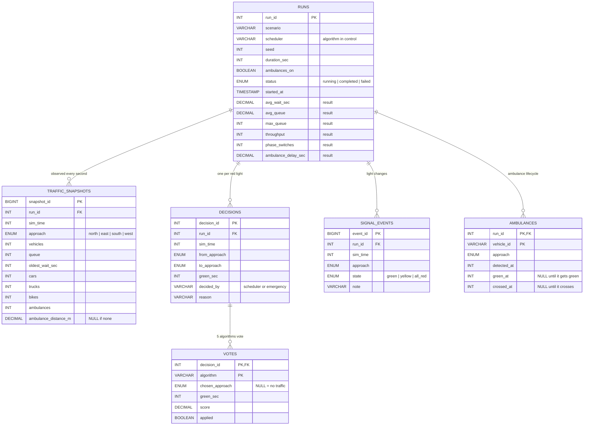

# Database ER Diagram: `traffic_control`

Source: [`schema.sql`](../schema.sql). Six tables. Every table except `votes` hangs off `runs`; `votes` hangs off `decisions`. Deleting a run deletes everything recorded for it (`ON DELETE CASCADE`).

## Keys and constraints

- **Primary keys:** surrogate `AUTO_INCREMENT` ids, except two composite keys. `votes (decision_id, algorithm)` allows exactly one vote per algorithm per red light, and `ambulances (run_id, vehicle_id)` allows one row per ambulance per run.
- **Unique:** `traffic_snapshots (run_id, sim_time, approach)` allows one reading per approach per second.
- **Indexes:** `decisions (run_id, sim_time)` and `signal_events (run_id, sim_time)` for timeline queries.
- **ENUMs** restrict approaches to `north/east/south/west`, light states to `green/yellow/all_red`, and run status to `running/completed/failed`.
- **Why `votes` is a separate table:** each red light has five votes. Storing them as rows instead of five column groups keeps the table in first normal form. It also makes "how often did algorithm X agree?" a simple `GROUP BY` (see `queries.sql` #4).
- **Emergency decisions** (`decided_by = 'emergency'`) have no votes, because the ambulance overrides the schedulers.
